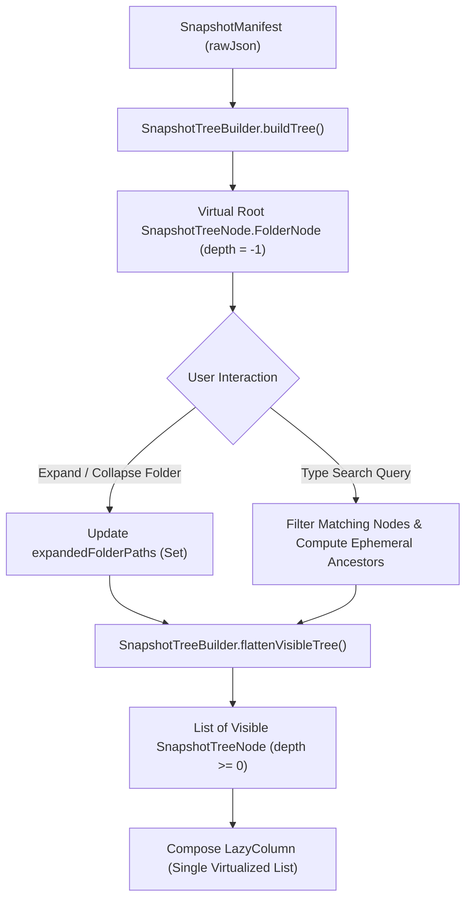
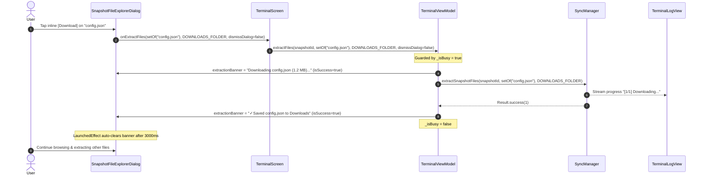

# Hierarchical Inline Accordion Tree Explorer & Selective Single-File Extraction

* **Author:** TeleBack Core Engineering
* **Status:** Approved
* **Date:** 2026-11-01

--------------------------------------------------------------------------------

## Overview

TeleBack provides encrypted decentralized snapshot backups to Telegram. Each backup snapshot records the complete directory structure and metadata manifest of the synchronized folder. This feature adds an interactive hierarchical accordion tree explorer directly within TeleBack. It allows users to browse past backup snapshots folder-by-folder, inspect file sizes and part counts, and selectively download or restore individual files without requiring a full device restoration.

## The Problem

Currently, TeleBack only exposes two restoration options:
1. **Full Snapshot Restore**: Restores every file in a snapshot back into the local folder. If a user only needs a single deleted document or an earlier version of one file, performing a full restore wastes cellular bandwidth, risks overwriting unaffected local files, and consumes excessive device storage.
2. **Flat File Explorer Dialog**: The existing `SnapshotFileExplorerDialog` lists all snapshot files in an unindented flat list of full file paths (e.g., `app/src/main/res/drawable/ic_logo.xml`). In large folders containing hundreds of nested files across dozens of subdirectories, this flat view is difficult to read, impossible to scan by folder, and lacks structural hierarchy.
3. **Modal Closure on Download**: Triggering an extraction currently dismisses the dialog immediately, returning the user to the terminal screen. Users who want to selectively restore multiple individual files must manually reopen the snapshot explorer repeatedly.

## Goals

* **Interactive Directory Navigation**: Render the snapshot folder hierarchy as an interactive inline accordion tree in `SnapshotFileExplorerDialog`, with expandable and collapsible directory nodes displaying folder names, item counts, and aggregate byte sizes.
* **On-Demand Single-File Extraction**: Enable users to tap inline action buttons on any file row (`[Folder]` or `[Download]`) to selectively extract that specific file to either the linked sync folder or Android's public `Downloads/TeleBack/` directory.
* **Persistent Browsing Context**: Keep the snapshot explorer dialog open during and after individual file extractions, providing an in-dialog status banner (`ExtractionBanner`) so users can extract multiple individual files in a single browsing session.
* **Cascading Batch Selection**: Allow users to check a folder node using `TriStateCheckbox` to recursively select or deselect all files in that directory and its nested subfolders.
* **Display Density Safeguards**: Restrict visual tree indentation to a maximum of 4 levels (48dp total indent) so file names and action buttons remain legible on compact phone screens (360–400dp width), showing direct parent directory hints in subtitles for deeply nested nodes.
* **Instant Search with Hierarchy Retention**: Filter files and folders by name or extension while ephemerally expanding matching ancestor folder nodes to retain structural context without polluting the user's manual expansion state.

## Non-Goals

* **No Android System DocumentsProvider**: This design will not expose TeleBack virtual snapshots to the native Android Files app (`com.android.documentsui`). All browsing remains within TeleBack.
* **No In-App File Viewers or Editors**: TeleBack will not render image previews, text editors, or PDF readers inside the app. Extracted files are written to storage where standard device viewer apps handle them.
* **No Floating Bottom Overlay Dock**: Download progress will rely on in-dialog status banners, the existing terminal console output stream (`TerminalLogView`), and system notifications from `SyncForegroundService`.
* **No Asynchronous Download Queue Manager**: TeleBack remains strictly sequential. Multi-task download queues (`Channel` / maps) are explicitly excluded in favor of the existing `_isBusy` lifecycle guard.
* **No Schema or Database Migrations**: Snapshot metadata stored in Room (`SnapshotEntity.rawJson`) already contains directory and file lists. No database alterations or Room schema increments will be made.
* **No `SnapshotPickerSheet` Manifest Parsing**: `SnapshotEntity` does not store directory counts in Room; JSON deserialization on list scrolling is explicitly rejected to prevent UI frame drops.

## Critical User Journeys (CUJs)

### CUJ 1: Selective Single-File Retrieval to Downloads
* **Given**: The user previously backed up a project containing nested subfolders, and deleted a configuration file (`config/settings.json`) on their phone.
* **When**: The user opens the latest snapshot in the file explorer, expands the `config/` directory, and taps the inline `[Download]` button on `settings.json`.
* **Then**: The file is downloaded, decrypted, and saved to `Downloads/TeleBack/config/settings.json`. An in-dialog confirmation banner appears, the explorer remains open, and the terminal logs verification of the SHA-256 digest.

### CUJ 2: Folder Batch Extraction to Linked Folder
* **Given**: The user wants to restore only their `documents/taxes/` folder from a snapshot taken last week.
* **When**: The user checks the checkbox on the `documents/taxes/` folder node and taps `To Folder (3 files)` in the bottom action bar.
* **Then**: All 3 descendant files are selected simultaneously, extracted to their original relative locations in the linked sync folder, and logged in the terminal without restoring any other folders.

### CUJ 3: Filtered Search in Nested Repositories
* **Given**: A snapshot contains 1,200 files across 8 directory levels. The user is searching for a `.pdf` report.
* **When**: The user types `.pdf` in the search filter field.
* **Then**: The file tree automatically filters to show matching `.pdf` files, ephemerally expanding their respective ancestor folders so the user can see which project subdirectory contains each document. Clearing the filter immediately restores the user's previous manual expansion state.

--------------------------------------------------------------------------------

## Technical Plan (Architecture)

### 1. Immutable Data Model & Pure Tree Builder

Instead of dynamically traversing and nesting components within Compose, the snapshot manifest is indexed once in memory into a pure recursive tree data structure, which is then flattened for virtualization.



#### Node Definitions (`SnapshotTreeNode.kt`)
Located in `app/src/main/java/com/teleback/presentation/restore/SnapshotTreeNode.kt`:

```kotlin
sealed class SnapshotTreeNode {
    abstract val name: String
    abstract val relativePath: String
    abstract val depth: Int

    data class FolderNode(
        override val name: String,
        override val relativePath: String,
        override val depth: Int,
        val children: List<SnapshotTreeNode>,
        val totalFilesCount: Int,
        val totalBytes: Long,
        val isEmptyFolder: Boolean = false
    ) : SnapshotTreeNode()

    data class FileNode(
        override val name: String,
        override val relativePath: String,
        override val depth: Int,
        val fileEntry: FileEntry
    ) : SnapshotTreeNode()
}

data class ExtractionBanner(
    val message: String,
    val isSuccess: Boolean
)
```

#### Tree Construction & Traversal Invariants
1. **Virtual Root Invariant**:
   - `SnapshotTreeBuilder.buildTree(manifest)` constructs a virtual root `FolderNode` with `depth = -1`, `name = ""`, and `relativePath = ""`.
   - Top-level files and directories in the snapshot linked folder are direct children of this virtual root with `depth = 0`.
2. **Deterministic Sibling Sorting**:
   - Within every directory level, children are sorted deterministically: folders first alphabetically (A–Z), followed by files alphabetically (A–Z):
     `children.sortedWith(compareBy({ it !is SnapshotTreeNode.FolderNode }, { it.name.lowercase() }))`
3. **Path Sanitization**:
   - Relative paths are sanitized to eliminate Windows backslashes and redundant leading/trailing delimiters prior to tokenization:
     `relativePath.replace('\\', '/').trim('/').split('/')`
4. **Post-Order Aggregation**:
   - `totalFilesCount` and `totalBytes` are computed via post-order traversal and accumulated into immutable `FolderNode` instances.
   - Folders recorded in `manifest.directories` that contain zero files are assigned `totalFilesCount = 0` and `isEmptyFolder = true`.
5. **Virtualized Flattening for `LazyColumn`**:
   - `flattenVisibleTree(root: FolderNode, expandedPaths: Set<String>, searchQuery: String): List<SnapshotTreeNode>` emits a flat list.
   - The virtual root (`depth = -1`) is **never emitted** into the list. Direct children start at `depth = 0`.
   - A node is emitted only if all of its ancestor folders are expanded.
6. **Stateless Search Auto-Expansion**:
   - When `searchQuery` is active:
     - Retains files matching the query by name or extension, and folders containing matching items.
     - Ancestors of matching items are computed ephemerally:
       `val effectiveExpanded = if (searchQuery.isBlank()) expandedPaths else (expandedPaths + matchingAncestors)`
     - Clearing `searchQuery` immediately restores the user's manual `expandedPaths` set without state pollution.

### 2. UI Layout & Viewport Safeguards

#### Indentation Capping
To prevent text truncation and crushed buttons on narrow screens:
- Indentation spacer width: `indent = min(node.depth, 4) * 12.dp`.
- Maximum horizontal offset is strictly limited to 48dp.
- For nodes where `depth > 4`, the direct parent directory hint is rendered in the subtitle (e.g., `../sub/deep/`).

#### Tri-State Cascading Selection
- Folders utilize `androidx.compose.material3.TriStateCheckbox`:
  - **Checked (`ToggleableState.On`)**: All descendant files in the subtree are present in `selectedPaths`.
  - **Unchecked (`ToggleableState.Off`)**: No descendant files in the subtree are present in `selectedPaths`.
  - **Indeterminate (`ToggleableState.Indeterminate`)**: Some, but not all, descendant files in the subtree are present.
- **Empty Folder Invariant**: If a folder has `totalFilesCount == 0`, `getFolderSelectionState` returns `false` (checkbox disabled) to prevent vacuous `true` selection bugs.
- Tapping a folder checkbox:
  - If currently `On` or `Indeterminate`: removes all descendant file paths from `selectedPaths`.
  - If currently `Off`: adds all descendant file paths to `selectedPaths`.

#### Folder & File Row Components
- **`FolderTreeRow`**:
  - Chevron indicator (`▾` for expanded, `▸` for collapsed).
  - Terminal folder glyph `[DIR]` with monospace styling.
  - Folder name and metrics badge (`4 files • 2.4 MB`).
  - `TriStateCheckbox` for cascading batch operations.
- **`FileTreeRow`**:
  - Checkbox for multi-select (48×48dp hit target).
  - Terminal file glyph `[FILE]` with monospace styling.
  - Base filename with `min(depth, 4) * 12.dp` indent.
  - Subtitle with formatted size (`SizeFormat.format(file.size)`), part count if chunked (`N parts`), and truncated SHA-256 prefix.
  - **Inline Quick Action Buttons**: Retains compact inline `[Folder]` and `[Download]` buttons directly on the row, avoiding nested modal sheets. Disabled while `isBusy` is `true`.

#### Bottom Action Bar
- Anchored to the bottom of `SnapshotFileExplorerDialog`:
  - `[To Folder (${selectedPaths.size})]` -> `onExtractFiles(selectedPaths, SYNCED_FOLDER, false)`
  - `[To Downloads (${selectedPaths.size})]` -> `onExtractFiles(selectedPaths, DOWNLOADS_FOLDER, false)`
- Displayed with aggregate item count and total size badges.
- Disabled while `isBusy` is `true`.

### 3. Sequential Execution & Persistent In-Dialog Banner



- **Sequential Execution Guard**:
  - When an extraction is running, `_isBusy` is `true`. All extraction buttons (`[Folder]`, `[Download]`, and the bottom action bar) are disabled to prevent concurrent socket contention or rate limits.
  - No coroutine channels or multi-task queue maps are used.
- **In-Dialog Status Banner**:
  - `TerminalViewModel` exposes `extractionBanner: StateFlow<ExtractionBanner?>`.
  - While extracting: `ExtractionBanner("Downloading <fileName>...", isSuccess = true)`.
  - On completion: `ExtractionBanner("✓ Saved <fileName> to <dest>", isSuccess = true)`.
  - On failure: `ExtractionBanner("✗ Failed: <errorMessage>", isSuccess = false)`.
  - `SnapshotFileExplorerDialog` displays the banner above the bottom action bar. A `LaunchedEffect(extractionBanner)` automatically clears the banner after 3000ms.

--------------------------------------------------------------------------------

## Alternatives Considered

### Alternative A: Android System DocumentsProvider Extension
* **Overview**: Implement an Android `DocumentsProvider` subclass to expose TeleBack snapshots directly into Android's native system Files app (`com.android.documentsui`).
* **Pros**: Native OS integration; any file picker intent from other apps could browse TeleBack snapshots directly.
* **Cons**:
  - Strict synchronous cursor queries in Android SAF create UI freezes when querying network manifests.
  - Handling multi-part encrypted chunk downloads on-demand during system file opens requires complex stub file descriptors and blocking I/O pipes.
  - Uncontrollable OS-level thumbnail generation requests flood the Telegram Bot API rate limits (HTTP 429).
* **Reason for Rejection**: High system friction, fragile lifecycle guarantees, and potential background OOM crashes compared to a fast, dedicated in-app tree.

### Alternative B: Breadcrumb Drilldown Navigation (Level-by-Level)
* **Overview**: Replace the tree with a drilldown file manager where tapping a folder opens that subdirectory full-width and displays a top breadcrumb path (`Home > documents > work`).
* **Pros**: Eliminates horizontal indentation concerns entirely; each directory view uses 100% viewport width.
* **Cons**:
  - Requires continuous back-and-forth navigation to view sibling directories or understand folder relationships.
  - Difficult to select multiple files across different folders simultaneously without an abstract, invisible selection basket.
  - Inefficient for scanning projects where files are distributed across multiple subdirectories.
* **Reason for Rejection**: The inline accordion layout provides an immediate, unified view of the entire snapshot hierarchy and was explicitly preferred during brainstorming.

### Alternative C: Floating Collapsible Bottom Dock
* **Overview**: Render a persistent floating dock anchored right above the system navigation bar showing download progress and completion.
* **Pros**: Globally visible progress widget accessible even if navigating between app screens.
* **Cons**:
  - Adds layout clutter and obscures the terminal input/command buttons.
  - Interacts poorly with Android system gesture navigation bars across different OEM skins.
  - Redundant with TeleBack's existing system foreground notification drawer and real-time terminal log console.
* **Reason for Rejection**: Dropped in favor of a clean in-dialog status banner combined with background terminal logging.

--------------------------------------------------------------------------------

## Non-Functional Requirements

### 1. Performance & Memory Safety
- **No Heavy In-Memory Allocations**: Large snapshots (up to 5,000 files) are parsed into lightweight data nodes once per snapshot opening. Tree flattening executes in <15ms on mid-range Android hardware.
- **Zero OOM Overhead**: Individual file extraction processes chunks sequentially via `FileChunker.DEFAULT_CHUNK_SIZE` (19 MB), streaming decrypted bytes directly to disk streams without loading entire multi-part files into RAM.

### 2. Concurrency & Sequential Integrity
- Operations are strictly sequential. Mutual exclusion is enforced via `_isBusy.value` in `TerminalViewModel`. Extraction buttons are disabled while `_isBusy` is `true`, preventing Telegram Bot API rate limits (HTTP 429).

### 3. Data Integrity & Overwrite Policy
- **Restore to Linked Folder (`SYNCED_FOLDER`)**: Restores and replaces the file at its relative path (atomic, digest-verified). If already identical, it skips (`RestoreOutcome.UP_TO_DATE`).
- **Export to Downloads (`DOWNLOADS_FOLDER`)**: Extracts safely with non-destructive version suffixing (`_1`, `_2`) via `SafStorageHelper.saveToDownloads` if an identical filename exists.
- Every extracted file is verified against its manifest `sha256` digest prior to marking the extraction complete.

--------------------------------------------------------------------------------

## Detailed Implementation Plan

### Target Files to Create/Modify

#### 1. `app/src/main/java/com/teleback/presentation/restore/SnapshotTreeNode.kt` (Create)
* **Type / Scope**: Presentation Data Model & Utility.
* **Proposed Changes**:
  - Define sealed class `SnapshotTreeNode` with immutable `FolderNode` and `FileNode`.
  - Define `data class ExtractionBanner(val message: String, val isSuccess: Boolean)`.
  - Implement pure utility object `SnapshotTreeBuilder`:
    - `fun buildTree(manifest: SnapshotManifest): FolderNode`: Assembles tree with virtual root (`depth = -1`, `name = ""`), deterministic sibling sorting (folders first A–Z, files A–Z), path sanitization, and post-order aggregation.
    - `fun flattenVisibleTree(root: FolderNode, expandedPaths: Set<String>, searchQuery: String): List<SnapshotTreeNode>`: Emits flat list omitting virtual root (top-level items start at `depth = 0`), respecting expanded state and ephemeral search expansion.
    - `fun getAllDescendantFilePaths(folder: FolderNode): Set<String>`: Recursively collects all child file paths.
    - `fun getFolderSelectionState(folder: FolderNode, selectedPaths: Set<String>): Boolean?`: Returns `false` if `totalFilesCount == 0`; otherwise returns `true` (all selected), `false` (none selected), or `null` (indeterminate).

#### 2. `app/src/main/java/com/teleback/presentation/restore/SnapshotFileExplorerDialog.kt` (Modify)
* **Type / Scope**: Jetpack Compose UI Component.
* **Proposed Changes**:
  - Accept parameters: `isBusy: Boolean`, `extractionBanner: ExtractionBanner?`, `onClearBanner: () -> Unit`, `onExtractFiles: (selectedPaths: Set<String>, destination: DownloadDestination, dismissDialog: Boolean) -> Unit`.
  - Replace flat `LazyColumn` items with virtualized `SnapshotTreeNode` items.
  - Implement `FolderTreeRow`:
    - Chevron expand/collapse toggle (`▾`/`▸`).
    - Folder terminal glyph `[DIR]`.
    - `TriStateCheckbox` linked to `getFolderSelectionState` and `getAllDescendantFilePaths`.
    - Indentation spacer: `min(depth, 4) * 12.dp`.
    - Direct parent subtitle crumb if `depth > 4`.
  - Implement `FileTreeRow`:
    - Terminal file glyph `[FILE]`.
    - Base filename with `min(depth, 4) * 12.dp` indent.
    - Size and chunk part count subtitle.
    - Checkbox for multi-select (48×48dp hit area).
    - Inline action buttons: `[Folder]` and `[Download]`, calling `onExtractFiles(setOf(file.relativePath), dest, false)`. Disabled when `isBusy` is `true`.
  - Implement bottom action bar with `[To Folder]` and `[To Downloads]`, passing `dismissDialog = false`.
  - Implement `ExtractionBanner` UI above the bottom bar with `LaunchedEffect` auto-dismiss after 3000ms.

#### 3. `app/src/main/java/com/teleback/presentation/terminal/TerminalViewModel.kt` (Modify)
* **Type / Scope**: Presentation ViewModel.
* **Proposed Changes**:
  - Update `extractFiles`:
    ```kotlin
    fun extractFiles(
        snapshotId: String,
        selectedPaths: Set<String>,
        destination: DownloadDestination,
        dismissDialog: Boolean = false
    )
    ```
  - Guard dialog dismissal:
    ```kotlin
    if (dismissDialog) {
        _browsingSnapshot.value = null
    }
    ```
  - Expose `extractionBanner: StateFlow<ExtractionBanner?> = _extractionBanner.asStateFlow()` and `fun clearExtractionBanner() { _extractionBanner.value = null }`.
  - Update `_extractionBanner` during extraction progress, success, and error states.

#### 4. `app/src/main/java/com/teleback/presentation/terminal/TerminalScreen.kt` (Modify)
* **Type / Scope**: Presentation UI Container.
* **Proposed Changes**:
  - Collect `isBusy by viewModel.isBusy.collectAsState()` and `extractionBanner by viewModel.extractionBanner.collectAsState()`.
  - Pass `isBusy`, `extractionBanner`, `onClearBanner = { viewModel.clearExtractionBanner() }`, and updated `onExtractFiles` callback with `dismissDialog` flag to `SnapshotFileExplorerDialog`.

#### 5. `app/src/test/java/com/teleback/presentation/restore/SnapshotTreeBuilderTest.kt` (Create)
* **Type / Scope**: JVM Unit Test Suite.
* **Proposed Changes**:
  - Test 1: `buildTree` correctly maps nested directories and aggregates file counts and byte sizes.
  - Test 2: Empty folders in `manifest.directories` are preserved with `isEmptyFolder = true` and `totalFilesCount = 0`.
  - Test 3: Sibling sorting orders folders before files alphabetically (A–Z).
  - Test 4: `flattenVisibleTree` omits virtual root (`depth = -1`) and emits top-level items with `depth = 0`.
  - Test 5: `flattenVisibleTree` correctly filters out children of unexpanded folders.
  - Test 6: Search query retains matching files and ephemerally expands ancestors without mutating manual expansion state.
  - Test 7: `getFolderSelectionState` on empty folder returns `false`.
  - Test 8: Tri-state selection calculations return `true`, `false`, and `null` accurately.
  - Test 9: Path sanitization normalizes backslashes and redundant slashes correctly.

#### 6. `docs/queue.md` (Modify)
* **Type / Scope**: Documentation / Release Queue.
* **Proposed Changes**:
  - Update Feature 2 entry with the finalized inline accordion architecture, de-scoped sequential extraction model, and test suite specifications.

### Verification Plan

* **Unit Testing**:
  - Run `SnapshotTreeBuilderTest` testing tree parsing, aggregation, flattening, sorting, and cascading selection.
* **Manual Verification CUJs**:
  - **CUJ 1**: Open snapshot file explorer -> expand folder -> tap inline `[Download]` on single file -> verify in-dialog status banner appears -> verify file downloaded to `Downloads/TeleBack/<relativePath>` -> verify explorer remains open.
  - **CUJ 2**: Tap checkbox on folder node -> verify all child files across nested subdirectories are selected -> verify indeterminate state when unchecking a single child -> extract batch to Synced Folder.
  - **CUJ 3**: Search for extension `.pdf` -> verify matching files are shown and parent folders are auto-expanded -> clear search -> verify previous manual expansion state is restored.
  - **CUJ 4**: Inspect directory deeper than 4 levels -> verify indentation is clamped at 48dp with direct parent directory subtitle hints.

--------------------------------------------------------------------------------

*Drafted and verified with EGM*
