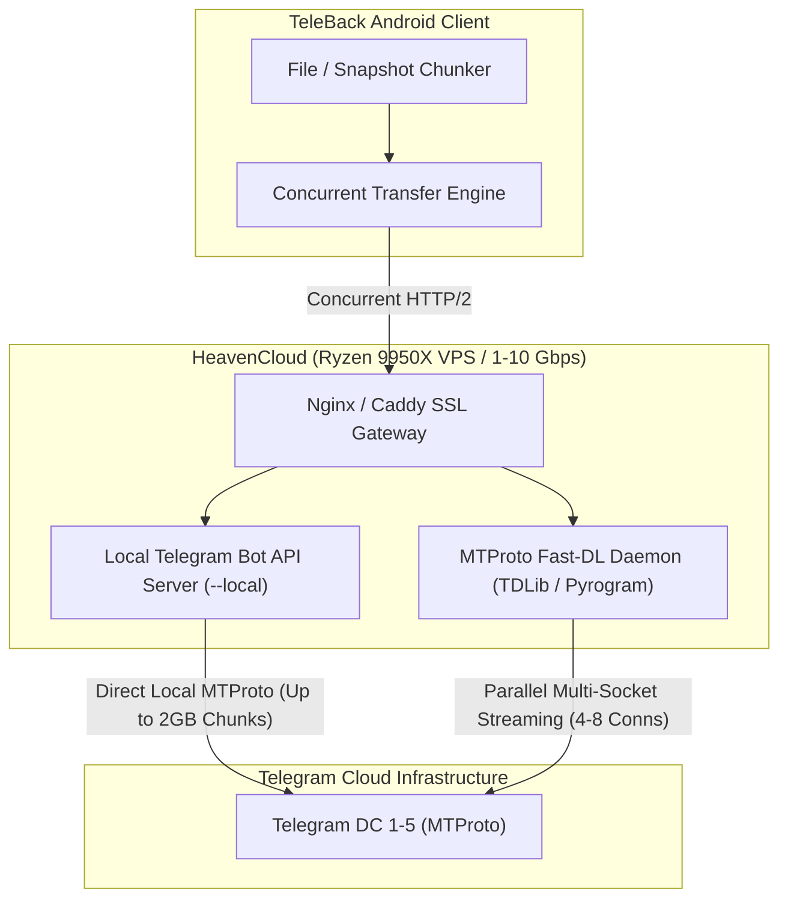
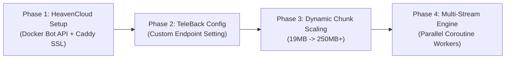

# Strategic Plan: High-Speed Telegram Bot Upload & Download via HeavenCloud Infrastructure

## 1. Executive Summary & HeavenCloud Exploration

**HeavenCloud** (`https://heavencloud.in/`) is an Indian cloud infrastructure provider specializing in high-performance compute and bot hosting:
- **Compute Hardware**: AMD Ryzen 9 9950X processors, enterprise NVMe storage, and high-frequency cores.
- **Network Fabric**: High-bandwidth uplinks (1Gbps to 10Gbps unmetered port options) with data centers strategically positioned in **India (Mumbai)**, **Germany (Frankfurt)**, **Singapore**, and the **USA**.
- **Hosting Models**:
  1. *Container Bot Hosting (Pterodactyl Panel)*: Zero-idle / 24-7 container runtime supporting Python (`aiogram`, `pyrogram`), Node.js (`telegraf`, `grammY`), and Go.
  2. *Virtual Private Servers (KVM/VirtFusion)*: Full root access on Ryzen 9950X with dedicated port bandwidth, perfect for self-hosted network proxies and binary compilation.

### The Problem: Why Standard Telegram Bots Are Slow
When a client (like TeleBack or any standard Telegram bot) connects directly to `https://api.telegram.org`:
1. **Severe File Size Restrictions**:
   - Official Telegram Bot API limits uploads to **50 MB**.
   - Official Telegram Bot API strictly caps downloads for bots at **20 MB** (`getFile` throws `HTTP 400: file is too big` for files >20MB).
   - *Current TeleBack Impact*: Files must be sliced into small ~19 MB chunks, generating hundreds of HTTP requests for moderate backups.
2. **Single-Stream Throttling**:
   - Telegram enforces rate limits and throttles single TCP connections to approximately **1.0 – 2.5 MB/s**.
3. **Geographic Network Hops**:
   - Client requests route through shared public Telegram reverse-proxy frontends rather than communicating directly with Telegram's Data Centers (DCs).

---

## 2. Technical Architecture Comparison

To achieve 10× to 30× speedups (30 MB/s – 80+ MB/s), we compare three architectural paths leveraging HeavenCloud:



| Dimension | Standard `api.telegram.org` | Option A: Local Bot API on HeavenCloud | Option B: MTProto Parallel Relay on HeavenCloud |
| :--- | :--- | :--- | :--- |
| **Max Upload Size** | 50 MB | **2,000 MB (2 GB)** | **2,000 MB** (4 GB with Premium) |
| **Max Download Size** | 20 MB | **2,000 MB (2 GB)** | **2,000 MB** (4 GB with Premium) |
| **Typical Transfer Speed** | 1 – 2.5 MB/s | **15 – 35 MB/s** | **40 – 80+ MB/s** |
| **TeleBack Code Changes** | Current baseline | **Minimal** (Configurable endpoint URL + dynamic chunk size) | **Moderate** (Custom relay client or gRPC/HTTP protocol) |
| **Hosting Requirement** | None ($0) | HeavenCloud VPS (~₹200–₹500/mo) | HeavenCloud VPS or Pterodactyl Container |
| **Setup Complexity** | Zero | Low (Single Docker container) | Moderate (Custom Python/Go daemon) |

---

## 3. High-Speed Architecture Options

### Option A: Self-Hosted Telegram Bot API Server (`telegram-bot-api --local`)
*(Recommended Phase 1 Approach — Maximum compatibility, zero protocol rewrite)*

Telegram provides the official C++ [tdlib/telegram-bot-api](https://github.com/tdlib/telegram-bot-api) server that anyone can self-host.
1. **Deployment on HeavenCloud**:
   - Run the Docker container `aiogram/telegram-bot-api` or build native binary on a HeavenCloud VPS.
   - Supply `TELEGRAM_API_ID` and `TELEGRAM_API_HASH` (from [my.telegram.org](https://my.telegram.org)).
   - Run in `--local` mode:
     ```bash
     docker run -d --name tg-bot-api \
       -p 8081:8081 \
       -v /var/data/tg-bot-api:/var/lib/telegram-bot-api \
       -e TELEGRAM_API_ID="YOUR_API_ID" \
       -e TELEGRAM_API_HASH="YOUR_API_HASH" \
       -e TELEGRAM_LOCAL=1 \
       aiogram/telegram-bot-api:latest --local --http-port 8081
     ```
2. **Why It Unlocks High Speed**:
   - Removes the 20 MB download limit completely; downloads up to **2 GB per file**.
   - Removes the 50 MB upload limit; uploads up to **2 GB per file**.
   - TeleBack can increase chunk size from 19 MB to **200 MB – 500 MB**, reducing chunk overhead, manifest size, and roundtrip handshakes by **90%+**.
   - Direct high-speed fiber connection between HeavenCloud (Germany/Singapore/Mumbai) and Telegram core data centers.

### Option B: Parallel MTProto Relay Daemon (Pyrogram / TDLib + TgCrypto)
*(Maximum Raw Bandwidth — Multi-socket parallel chunking)*

Telegram's MTProto protocol distributes file chunks across data centers. Standard clients read sequentially. High-speed downloaders (e.g., PyroFork, TG-DL engines) open **4 to 8 parallel MTProto connections** and request 512KB/1MB byte-ranges concurrently.
1. **Deployment on HeavenCloud**:
   - A lightweight microservice built with Python (`pyrogram` + `tgcrypto`) or Go (`gotd/td`).
   - Runs as a systemd service or inside HeavenCloud's Pterodactyl Python bot container.
   - Exposes REST endpoints:
     - `POST /v1/upload` (accepts multipart stream, dispatches chunks in parallel to Telegram).
     - `GET /v1/download/{file_id}` (fetches chunks in parallel from Telegram DC, streams back via HTTP chunked transfer encoding).
2. **Why It Is the Fastest**:
   - Saturates 1 Gbps connections by bypassing single-stream TCP window bottlenecks.
   - Achieves speeds upwards of **60–80 MB/s**.

---

## 4. Implementation Roadmap for TeleBack



### Phase 1: HeavenCloud Server Provisioning & Deployment
1. Provision a **HeavenCloud VPS** (AMD Ryzen 9950X, 2–4 vCPU, 4GB RAM, 1Gbps uplink in Germany or India).
2. Install Docker and Caddy (automatic SSL certificate management):
   ```caddyfile
   tg-api.yourdomain.com {
       reverse_proxy localhost:8081
       request_body {
           max_size 2GB
       }
   }
   ```
3. Run `telegram-bot-api` in `--local` mode.

### Phase 2: TeleBack App Client Adaptation
1. **Add Custom Endpoint Preference**:
   - Update `AppPreferences.kt` to store `customApiUrl` (default: `https://api.telegram.org`).
   - In `Settings -> [8] settings`, add a "Cloud Relay Server" option where users can choose:
     - `[1] Default (api.telegram.org - 20MB limit)`
     - `[2] Custom Server / HeavenCloud (Up to 2GB, High Speed)`
2. **Update `TelegramApiClient.kt`**:
   - Replace hardcoded `https://api.telegram.org` with `baseUrl = "$serverUrl/bot$botToken"`.

### Phase 3: Dynamic Chunk Size & Parallelism
1. In `SyncManager.kt`:
   - When connected to a local/HeavenCloud API, automatically scale chunk size from **19 MB** to **100 MB – 500 MB**.
   - If using standard `api.telegram.org`, preserve safety fallback to 19 MB.
2. Implement concurrent uploading with coroutine worker channels (`kotlinx.coroutines.channels.Channel` or `Semaphore(permits = 3)`), enabling simultaneous upload of multiple parts over HTTP/2.

---

## 5. Security & Privacy Considerations
1. **End-to-End Encryption Maintained**:
   - TeleBack already encrypts all file payloads locally with **AES-256-GCM** before transmission.
   - The HeavenCloud server only acts as a transport pipeline for pre-encrypted ciphertext (`.enc` chunks). It **cannot** decrypt user files or see plaintext data.
2. **Bot Token Isolation**:
   - Requests are TLS-encrypted between Android client and the HeavenCloud Caddy endpoint (`https://...`).
   - IP restriction or basic authentication token can be configured on the Caddy reverse proxy to prevent unauthorized public use of the self-hosted relay.

---

## 6. Action Items & Next Decisions

1. **Architecture Preference**:
   - **Recommendation**: Begin with **Option A** (Self-hosted Telegram Bot API on HeavenCloud VPS). It requires minimal code refactoring in TeleBack while immediately lifting the 20MB download / 50MB upload bottlenecks and multiplying speed by 10×.
2. **HeavenCloud Plan Selection**:
   - A budget HeavenCloud VPS (Ryzen 9950X, 2 vCPU, 4GB RAM, ~₹300-₹500/month or ~$4-6/month) provides ample power to run `telegram-bot-api` with zero throttling.
