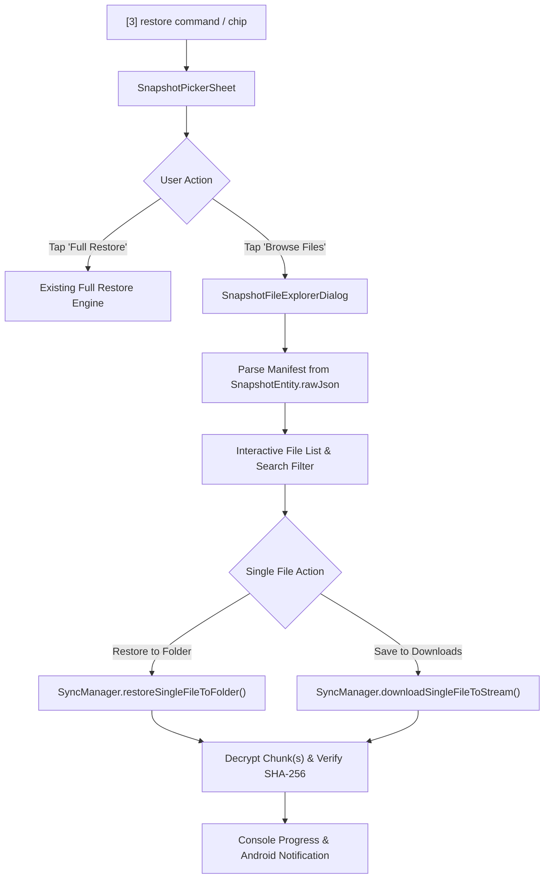

# Plan: Selective Single-File Download & Extraction from Snapshots

This document details the architectural plan to allow users to inspect and download specific individual files from previous cloud snapshots without having to perform a complete folder restore.

---

## 1. Feature Overview

Currently, command `[3] restore` triggers a full sync restore of all files in a chosen snapshot into the local folder. The new feature will allow users to:
1. **Browse File Contents of Any Snapshot**: View all files, directory trees, file sizes, and hashes stored within any snapshot without downloading them first.
2. **Search / Filter Files**: Quickly search by file name, relative path, or extension (e.g. `.pdf`, `.png`, `notes.txt`).
3. **Flexible Download Destinations**:
   - **Restore to Linked Folder**: Restores the selected file directly to its original relative location in the linked directory.
   - **Export / Save As (Downloads)**: Downloads and decrypts the single file directly to Android's `Downloads` directory or via SAF file picker.

---

## 2. Technical Architecture & Component Changes

### A. Core / Domain Layer ([`SyncManager.kt`](file:///c:/Users/Jaheen/Documents/Projects/App_TeleBack/app/src/main/java/com/teleback/domain/SyncManager.kt))
- **`restoreSingleFile(snapshotId: String, relativePath: String, destinationUri: Uri? = null, onLog: (TerminalLog) -> Unit): Result<Unit>`**:
  - Locates `SnapshotEntity` from Room database and parses `SnapshotManifest`.
  - Finds the matching `FileEntry`.
  - Reassembles chunked/encrypted Telegram parts via existing `downloadPart` and `CryptoEngine.decryptBytes`.
  - Verifies SHA-256 digest against `entry.sha256`.
  - If `destinationUri` is null, writes into the linked folder via `safHelper.openRestoreTarget(folderUri, relativePath)`.
  - If `destinationUri` is provided (e.g. MediaStore or SAF `CreateDocument`), writes directly to that output stream.

### B. Storage Layer ([`SafStorageHelper.kt`](file:///c:/Users/Jaheen/Documents/Projects/App_TeleBack/app/src/main/java/com/teleback/core/storage/SafStorageHelper.kt))
- Add helper method `saveFileToDownloads(context, fileName, mimeType, writeBlock): Uri?` using `MediaStore.Downloads` (Android 10+ / API 29+) or custom destination stream.

### C. Presentation & UI Layer
1. **[`SnapshotPickerSheet.kt`](file:///c:/Users/Jaheen/Documents/Projects/App_TeleBack/app/src/main/java/com/teleback/presentation/restore/SnapshotPickerSheet.kt)**:
   - Enhance each snapshot card to provide two distinct action chips:
     - `[Full Restore]`: Standard complete snapshot restore.
     - `[Browse Files]`: Opens the file selection dialog for this snapshot.
2. **`SnapshotFileExplorerDialog.kt` (New UI Component)**:
   - Retro terminal styling consistent with TeleBack themes.
   - Header showing Snapshot Tag, ID, and total file count / size.
   - Search filter `TextField` for instant fuzzy filtering.
   - Scrollable list of files showing:
     - File path & name
     - Formatted size (`SizeFormat.format(file.size)`)
     - Chunk indicator (e.g. `1 part` or `N chunks`)
     - Two download buttons: `[To Folder]` and `[To Downloads]`.
3. **[`TerminalViewModel.kt`](file:///c:/Users/Jaheen/Documents/Projects/App_TeleBack/app/src/main/java/com/teleback/presentation/terminal/TerminalViewModel.kt)**:
   - State flows:
     - `selectedSnapshotForBrowsing: StateFlow<SnapshotEntity?>`
   - Actions:
     - `browseSnapshotFiles(snapshotId: String)`
     - `downloadSingleFile(snapshotId: String, relativePath: String, toDownloads: Boolean)`
   - Terminal logging: logs each file download step, chunk verification, decryption, and final write status.

---

## 3. Implementation Phases

| Phase | Description | Deliverables |
| :--- | :--- | :--- |
| **Phase 1** | **Domain & Engine Extension** | Add `downloadSingleFileToStream` & `restoreSingleFile` to `SyncManager.kt` with chunk download, decryption & SHA-256 checks. |
| **Phase 2** | **Downloads & SAF Storage Support** | Implement `saveToDownloads` helper in `SafStorageHelper.kt` with MediaStore fallback. |
| **Phase 3** | **Interactive Snapshot Explorer UI** | Create `SnapshotFileExplorerDialog.kt` with search, filter, and file action buttons. |
| **Phase 4** | **ViewModel & Sheet Integration** | Wire actions in `SnapshotPickerSheet.kt`, `TerminalViewModel.kt`, and `TerminalScreen.kt`. |
| **Phase 5** | **Testing & Verification** | Unit tests for single-file retrieval, chunk reassembly, and edge case handling (encrypted & chunked files). |

---

## 4. Key Questions & Design Decisions

1. **Download Destinations**:
   - Should we support **both** *Restore into original linked folder* AND *Export to device Downloads*, or prioritize one first?
2. **Multi-Selection**:
   - Would you like multi-file selection (checkboxes to download 3 or 4 chosen files together), or start with single-file download first?
