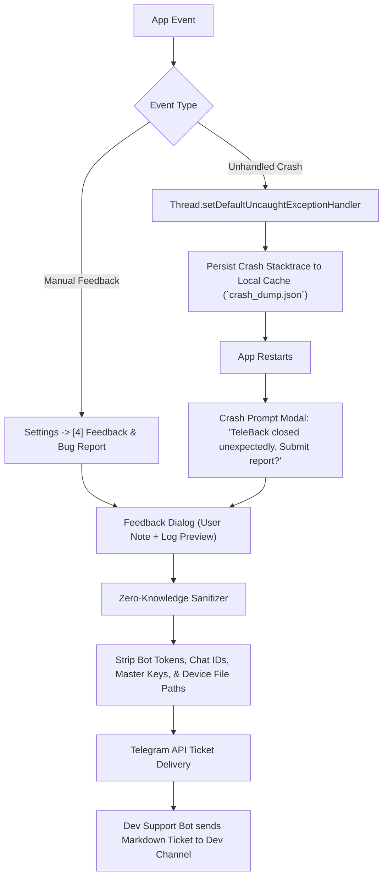

# Phase 11: Telegram Diagnostics & Feedback Hub — Implementation Plan

## 1. Clarification on Option A (Developer Bot & Channel)

> [!NOTE]
> **Yes.** Under **Option A**, you (as the app author/developer) would create:
> 1. A single **Developer Support Bot** via `@BotFather` (e.g., `@TeleBackSupportBot`).
> 2. A private Telegram **Developer Log Channel or Group** where only you and your bot reside.
> 3. The developer bot token and channel ID are baked into the build (obfuscated in `BuildConfig` or encrypted strings).
> 
> **Why this is advantageous:**
> - Zero setup for end users: Users never have to configure anything to send a report.
> - Keeps user backup groups clean: The user's cloud backup group won't be cluttered with system crash logs.
> - Centralized monitoring: You receive tickets and crash reports from all app installations in one organized feed.
> - **Fallback Support:** If the app is offline or the dev bot cannot be reached, the report can still provide a one-click *"Share / Copy Log"* fallback.

---

## 2. Proposed Architecture & Workflow



---

## 3. Detailed Component Plan

### 3.1. Zero-Knowledge Sanitizer (`LogSanitizer.kt`)
Before any string leaves the device:
- **Bot Tokens:** Matches and replaces `\d{8,10}:[A-Za-z0-9_-]{35}` with `[REDACTED_BOT_TOKEN]`.
- **Chat IDs:** Replaces user's active Chat ID with `[REDACTED_CHAT_ID]`.
- **Cryptographic Keys:** Replaces any 44-char Base64 AES master key or derived passphrase hashes with `[REDACTED_MASTER_KEY]`.
- **Absolute Local Storage Paths:** Replaces `/storage/emulated/0/...` with relative paths like `[DIR]/...`.

### 3.2. Uncaught Crash Handler (`CrashHandler.kt`)
- Hooks into `Thread.setDefaultUncaughtExceptionHandler` inside `TeleBackApp.onCreate()`.
- Captures:
  - Exception class, message, and full stacktrace.
  - Recent terminal log buffer (last 50 lines).
  - Device telemetry: Android OS version, SDK level, Device Manufacturer & Model, App Version code & name.
- Flushes the payload to a local cache file: `crash_dump.json`.
- Passes through to Android's default handler so standard system teardown occurs cleanly.

### 3.3. Next-Launch Crash Prompt & Manual Trigger
- **Next Launch**: If `crash_dump.json` exists in app cache on startup, `TerminalViewModel` surfaces a cyber-styled prompt:
  - *"TeleBack closed unexpectedly. Would you like to transmit a diagnostic report?"*
  - `[Review & Send]` or `[Dismiss]` (dismissing deletes `crash_dump.json`).
- **Manual Trigger**: Added to the 2-column Settings grid as `[4] feedback` (`"Bug report / feedback"`).
  - Row 1: `[1] theme` | `[2] keys`
  - Row 2: `[3] auto`  | `[4] feedback`
  - Row 3: `[<] back`  (spanning or paired)

### 3.4. Developer Bot Delivery Client (`FeedbackManager.kt`)
- Direct OkHttp call to Telegram Bot API `sendMessage` (or `sendDocument` with `diagnostic.log` if the log exceeds 4096 characters).
- Formats a developer ticket:
  ```text
  🚨 #CRASH_REPORT [v2.6 #8]
  📅 2026-10-22 12:00:00 UTC
  📱 Pixel 8 Pro (Android 15, API 35)
  👤 User Note: "Happened during large file sync"

  📋 Stacktrace:
  java.lang.NullPointerException: ...
  
  📜 Terminal Tail (Sanitized):
  [OK] Cloud catalog synchronized
  [SYNC] Processing 42 files...
  ```

---

## 4. Implementation Steps

1. **Create `LogSanitizer.kt` & Unit Tests**: Verify regex and string pattern redactions for keys, tokens, and paths.
2. **Implement `CrashHandler.kt`**: Register in `TeleBackApp.kt` and manage `crash_dump.json`.
3. **Build `FeedbackDialog.kt`**: Compose dialog displaying editable user comment, sanitized log/crash preview, and send action.
4. **Update `CommandGrid.kt`**: Add `[4] feedback` to the Settings sub-view and wire it to `TerminalViewModel`.
5. **Implement `FeedbackManager.kt`**: Handle delivery via developer bot with graceful offline fallback (copy/share intent if offline).
