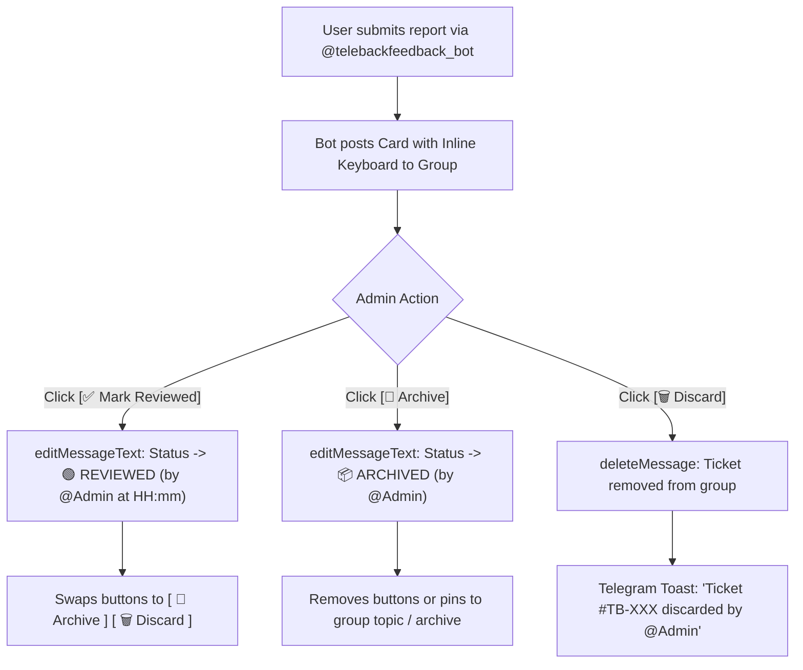

# Telegram Feedback Hub — Interactive Ticket Review Workflow

## 1. Overview & Objective

To transform incoming feedback cards in your **`TeleBack Feedbacks`** group (`-1003900951055`) into an interactive triage system, `@telebackfeedback_bot` will attach **Inline Keyboard buttons** directly below each incoming ticket:

```text
🚨 #CRASH_REPORT • Ticket #TB-20261022-01
━━━━━━━━━━━━━━━━━━━━━━━━━━━━━━━━━━━━━━━━
📱 Device   : Pixel 8 Pro (Android 15, API 35)
📦 Version  : v2.6 (Code 8)
📅 Time     : 2026-10-22 12:45 UTC
👤 User     : @username (ID: 987654321)
💬 Note     : "App closed when restoring snapshot"

📋 Sanitized Logs:
[OK] Vault opened
[ERR] java.lang.NullPointerException...

━━━━━━━━━━━━━━━━━━━━━━━━━━━━━━━━━━━━━━━━
Status: 🔴 UNREVIEWED
[ ✅ Mark Reviewed ]   [ 📁 Archive ]   [ 🗑 Discard ]
```

---

## 2. Interactive Action States

When an admin clicks any button, the bot intercepts the `callback_query`, updates the message in-place via `editMessageText` (or deletes it if discarded), and answers the callback with a Telegram toast notification:



---

## 3. Button Behaviors & Visual Updates

### 1. `[ ✅ Mark Reviewed ]`
- **Action**: Verifies that the developer has inspected the ticket.
- **Message Update**:
  - Replaces header status `🔴 UNREVIEWED` with `🟢 REVIEWED (by @jaheen at 2026-10-22 13:15 UTC)`.
  - Replaces the `[Mark Reviewed]` button with `[ 🔄 Reopen ]`.

### 2. `[ 📁 Archive ]`
- **Action**: Marks the bug as resolved or logged into GitHub Issues/Roadmap.
- **Message Update**:
  - Replaces header status with `📦 ARCHIVED / RESOLVED`.
  - Clears the inline keyboard so the card becomes a permanent, tamper-free historical record.
  - *(Optional)* If the group has **Forum Topics** enabled, moves or links the message to the `#Archived` topic.

### 3. `[ 🗑 Discard ]`
- **Action**: For spam, duplicate reports, or test messages.
- **Message Update**:
  - Calls Telegram API `deleteMessage` on the ticket card.
  - Sends ephemeral notification callback to the admin: *"Ticket discarded and removed."*

---

## 4. Implementation in the Bot Script (`main.py`)

Here is the exact Python implementation for `@telebackfeedback_bot` using `pyTelegramBotAPI`:

```python
import os
import telebot
from telebot.types import InlineKeyboardMarkup, InlineKeyboardButton
from datetime import datetime

BOT_TOKEN = os.getenv("BOT_TOKEN")
GROUP_ID = int(os.getenv("GROUP_ID", "-1003900951055"))

bot = telebot.TeleBot(BOT_TOKEN)

def build_ticket_markup(status="unreviewed"):
    markup = InlineKeyboardMarkup(row_width=3)
    if status == "unreviewed":
        markup.add(
            InlineKeyboardButton("✅ Review", callback_data="review"),
            InlineKeyboardButton("📁 Archive", callback_data="archive"),
            InlineKeyboardButton("🗑 Discard", callback_data="discard")
        )
    elif status == "reviewed":
        markup.add(
            InlineKeyboardButton("🔄 Reopen", callback_data="reopen"),
            InlineKeyboardButton("📁 Archive", callback_data="archive"),
            InlineKeyboardButton("🗑 Discard", callback_data="discard")
        )
    return markup

@bot.message_handler(func=lambda msg: True, content_types=['text', 'document'])
def handle_user_submission(message):
    # Only forward private messages sent to the bot by users
    if message.chat.type != "private":
        return

    user_info = f"@{message.from_user.username}" if message.from_user.username else f"User {message.from_user.id}"
    header = (
        f"📩 **NEW TICKET** from {user_info}\n"
        f"━━━━━━━━━━━━━━━━━━━━━━━━━━━━\n"
        f"Status: 🔴 **UNREVIEWED**\n\n"
    )
    
    report_content = message.text or (message.caption or "[Document/Log attached]")
    full_card = header + report_content

    # Post card with inline review keyboard into the admin group
    bot.send_message(
        chat_id=GROUP_ID,
        text=full_card,
        reply_markup=build_ticket_markup("unreviewed"),
        parse_mode="Markdown"
    )
    bot.reply_to(message, "✅ **Ticket received!** The team has been notified.")

@bot.callback_query_handler(func=lambda call: True)
def handle_ticket_actions(call):
    admin_name = f"@{call.from_user.username}" if call.from_user.username else call.from_user.first_name
    timestamp = datetime.utcnow().strftime("%Y-%m-%d %H:%M UTC")
    current_text = call.message.text

    if call.data == "review":
        updated_text = current_text.replace("🔴 UNREVIEWED", f"🟢 REVIEWED (by {admin_name} at {timestamp})")
        bot.edit_message_text(
            chat_id=call.message.chat.id,
            message_id=call.message.message_id,
            text=updated_text,
            reply_markup=build_ticket_markup("reviewed")
        )
        bot.answer_callback_query(call.id, "Marked as Reviewed! 🟢")

    elif call.data == "reopen":
        updated_text = current_text.split("\n\n", 1)[0]
        # Reset back to unreviewed
        reopened_text = "🔴 UNREVIEWED\n\n" + current_text.split("\n\n", 1)[1]
        bot.edit_message_text(
            chat_id=call.message.chat.id,
            message_id=call.message.message_id,
            text=reopened_text,
            reply_markup=build_ticket_markup("unreviewed")
        )
        bot.answer_callback_query(call.id, "Ticket Reopened 🔴")

    elif call.data == "archive":
        archived_text = current_text.replace("🔴 UNREVIEWED", f"📦 ARCHIVED (by {admin_name})")
        archived_text = archived_text.replace("🟢 REVIEWED", f"📦 ARCHIVED (by {admin_name})")
        bot.edit_message_text(
            chat_id=call.message.chat.id,
            message_id=call.message.message_id,
            text=archived_text,
            reply_markup=None  # Remove buttons
        )
        bot.answer_callback_query(call.id, "Ticket Archived 📦")

    elif call.data == "discard":
        bot.delete_message(chat_id=call.message.chat.id, message_id=call.message.message_id)
        bot.answer_callback_query(call.id, "Ticket Discarded 🗑")
```

---

## 5. Security & Isolation Benefits
- **Zero App Changes Needed**: The Android app simply formats the ticket and opens `@telebackfeedback_bot`.
- **Bot Handles Everything**: The bot server-side receives the ticket, applies the inline buttons, and manages the interactive state changes.
- **Group Stays Organized**: Non-urgent crashes can be discarded with one tap, reviewed tickets are visibly stamped with the admin username and timestamp, and resolved issues are cleanly archived.
